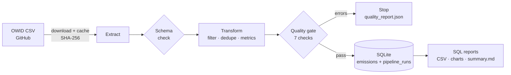

# CO₂ Emissions Data Pipeline


A tested, reproducible ETL pipeline that turns the public **Our World in Data CO₂ dataset** (50,000+ rows, 79 columns, countries mixed with regional aggregates) into a clean, analysis-ready SQLite database, then answers business questions with SQL.

**The question it answers:** *How do Canada and Brazil compare on emissions, and which economies are growing while cutting CO₂?*

> Built with Python (pandas), SQL (SQLite window functions), pytest and GitHub Actions.

---

## Key findings (2024 data)


- **Canada emits 13.4 t of CO₂ per person**, almost 3× the all-country average (4.6 t), ranking **11th of 159** countries with 1M+ people. Brazil emits 2.3 t (87th).
- **Canada's total CO₂ is down 6.5% since 2005**, its Paris Agreement baseline year. The UK (−45%) and Germany (−34%) cut much faster. Canada's 2030 target is 40–45% below 2005, but that target covers *all* greenhouse gases, so this dataset gives context, not a direct measure of progress.
- **Canada has decoupled growth from emissions:** between 2005 and 2022 (latest GDP year), its GDP grew 34% while CO₂ fell 4%. Brazil's GDP grew 50% and CO₂ grew 32% (relative decoupling).
- Across 153 countries, **43 show absolute decoupling** (GDP up, CO₂ down), 63 relative, 47 none.


---

## Architecture



| Step | Module | What it does |
|---|---|---|
| Extract | `extract.py` | Downloads the CSV with a local cache (re-downloads after `max_age_days`), writes atomically, records a SHA-256 checksum. `--offline` runs from cache only. |
| Schema check | `validate.py` | Fails fast if the upstream file loses a required column. |
| Transform | `transform.py` | Renames columns with explicit units (`co2_mt`, `gdp_usd`), drops regional aggregates (no ISO code), filters years, deduplicates on the composite key `(iso_code, year)`, and derives metrics. Pure functions, no in-place mutation. |
| Quality gate | `validate.py` | Error-level checks stop the run *before* anything is loaded; warnings are logged. |
| Load | `load.py` | Writes to SQLite with a **unique index on `(iso_code, year)`**, so the database itself enforces the key. Every run is logged in `pipeline_runs` (source checksum, config hash, row counts). |
| Report | `report.py` + `sql/` | Four SQL analyses using CTEs and window functions, exported to CSV, plus two charts and a Markdown run summary. |

### Derived metrics

| Column | Definition |
|---|---|
| `co2_per_capita_t` | CO₂ (Mt) × 10⁶ ÷ population, recomputed rather than copied, then reconciled against the source |
| `co2_per_gdp_kg` | kg of CO₂ per US$ of GDP (carbon intensity) |
| `yoy_change_pct` | Change vs. previous year, **only when the previous year exists** (no fake YoY across gaps) |
| `change_vs_baseline_pct` | Change vs. `baseline_year` (default 2005) |
| `coal/oil/gas_share_pct` | Share of total CO₂ by fuel |

### Data-quality checks

| Check | Severity | Rule |
|---|---|---|
| `unique_key` | error | No duplicate `(iso_code, year)` |
| `non_negative_values` | error | Population and emissions ≥ 0 |
| `null_share[col]` | error | Missing share below the configured limit |
| `per_capita_reconciliation` | warning | Recomputed per-capita value within 2% of the source |
| `components_not_above_total` | warning | Fuel + industry components never exceed total CO₂ |
| `year_continuity` | warning | No gaps in each country's yearly series |

---

## Quick start

```bash
git clone https://github.com/YOUR-USERNAME/co2-emissions-pipeline.git
cd co2-emissions-pipeline
python -m venv .venv
source .venv/bin/activate          # Windows: .venv\Scripts\activate
pip install -e ".[dev]"

python -m emissions_pipeline --config config/pipeline.yaml
```

Outputs land in `output/`:

```
output/
├── emissions.db               # SQLite: emissions, focus_countries, pipeline_runs
└── reports/
    ├── summary.md             # run metadata, row audit, quality table, key results
    ├── quality_report.json
    ├── top_emitters_latest.csv
    ├── per_capita_ranking.csv
    ├── focus_vs_baseline.csv
    ├── decoupling.csv
    ├── per_capita_trend.png
    └── change_vs_baseline.png
```

Exit codes: `0` success, `2` config/download/schema error, `3` data-quality gate failed.

### Configuration

All parameters live in [`config/pipeline.yaml`](config/pipeline.yaml): year range, baseline year, focus countries and quality thresholds. A hash of the file is stored with every run, so any output can be traced back to the exact parameters that produced it.

### Querying the database

```sql
-- Canada's five largest year-over-year drops since 1990
SELECT year, ROUND(co2_mt, 1) AS co2_mt, ROUND(yoy_change_pct, 1) AS yoy_pct
FROM emissions
WHERE iso_code = 'CAN' AND yoy_change_pct IS NOT NULL
ORDER BY yoy_change_pct
LIMIT 5;
```

---

## Testing

```bash
pytest --cov
```

56 tests, 99% coverage, no network access needed: tests run against a small synthetic CSV served through a `file://` URL.

- **Unit tests** for every transform (aggregate filtering, deduplication, YoY across gaps, zero denominators, input not mutated) and every quality check.
- **Extract tests** for caching, staleness, offline mode and atomic downloads (a failed download leaves no partial file).
- **End-to-end tests** that run the full pipeline and assert on report values, idempotent re-runs, run logging, the database-enforced key, and that a failed quality gate loads nothing.
- CI runs `ruff` and the test suite on Python 3.10 and 3.12 for every push.

### Issues the tests and checks caught

1. **Integer division in SQL.** SQLite divides `INTEGER / INTEGER` as an integer (420 / 350 = 1), which silently misclassified a country in the decoupling report. Fixed by casting measures to float in the transform *and* forcing real division in SQL; a regression test keeps it fixed.
2. **Rounding in the source.** The per-capita reconciliation flagged 63 rows. Investigation showed they were all micro-states (Niue, Tuvalu, Saint Helena) where the source rounds total CO₂ to 0.001 Mt, which alone shifts per-capita values by ~5%. The check now excludes rows below 0.1 Mt, and every remaining row matches the source within 2%.

---

## Limitations

- **CO₂ from fossil fuels and industry only.** Land-use change (deforestation) is excluded, and it is Brazil's largest emission source, so Brazil's footprint is understated here. Other greenhouse gases (methane, N₂O) are also out of scope.
- Emissions are **territorial** (where they are produced), not consumption-based.
- GDP is published with a lag, so the decoupling analysis ends at the latest year with GDP data (2022).

## Project structure

```
├── config/pipeline.yaml        # versioned run parameters
├── src/emissions_pipeline/
│   ├── cli.py                  # entry point and exit codes
│   ├── config.py               # typed, validated config
│   ├── extract.py              # cached, checksummed download
│   ├── transform.py            # pure transformation functions
│   ├── validate.py             # schema + data-quality checks
│   ├── load.py                 # SQLite load and run log
│   ├── report.py               # SQL reports, charts, summary
│   ├── pipeline.py             # orchestration
│   └── sql/*.sql               # analyses (CTEs, window functions)
├── tests/                      # pytest suite + synthetic fixtures
└── .github/workflows/ci.yml    # lint + tests on every push
```

## Data source

Hannah Ritchie, Pablo Rosado and Max Roser (2023), *CO₂ and Greenhouse Gas Emissions*, Our World in Data, [github.com/owid/co2-data](https://github.com/owid/co2-data). Licensed under [CC BY 4.0](https://creativecommons.org/licenses/by/4.0/).

## Author

**Matheus Legnani Wilken** · Data Analyst · [LinkedIn](https://www.linkedin.com/in/matheus-lw/)
